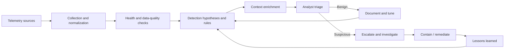
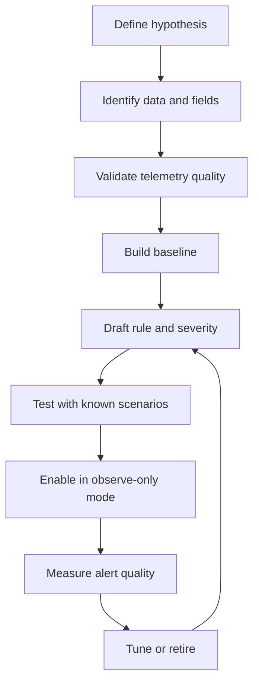

# Security Monitoring Sensor Design

A portfolio case study that turns seven monitoring areas into documented detection hypotheses, alert logic, tuning requirements, and response playbooks.

**Project type:** Individual academic cybersecurity project  
**Program:** Lighthouse Labs  
**Completed:** 2024  
**Original scenario:** “Cat Scan II / Big Dog” fictional environment  
**Scope:** Monitoring and detection design; live production deployment is not claimed

## Project summary

The original academic report proposed monitoring across seven areas:

1. HTTP response time and availability
2. MySQL database activity
3. SSH authentication
4. Antivirus or endpoint-security health
5. Critical-file integrity
6. Windows event and service activity
7. Bandwidth and network connections

For each area, the report connected telemetry to possible Indicators of Compromise (IoCs), vulnerabilities, business risks, thresholds, and security recommendations.

This portfolio version preserves that work while making the detection logic more operationally accurate. A threshold alert is treated as a **signal for investigation**, not proof of a particular attack. Every proposed detection includes required context, likely false positives, validation steps, and an initial response path.

## Monitoring workflow

## Sensor catalogue

| Monitoring area | Original starting point | What the signal can support | Important limitation |
|---|---|---|---|
| HTTP response time | Warning above 3 seconds; alert above 5 seconds | Availability degradation or abnormal performance | Latency alone cannot identify DDoS or DNS hijacking |
| MySQL activity | Slow queries above 3 seconds; query volume above 1.5× baseline | Database stress or unusual activity requiring review | Query time or volume alone cannot prove SQL injection or exfiltration |
| SSH authentication | More than 5 failed attempts; successful access from an unknown source | Brute-force or unusual remote-access triage | Known/unknown IP logic needs identity, asset, VPN, and maintenance context |
| Endpoint-security health | Protection disabled over 5 minutes or definitions over 7 days old | Control degradation or tampering investigation | A health alert is not evidence that malware is present |
| File integrity | Two or more critical-file changes in 10 minutes | Unexpected change or persistence investigation | Legitimate patching and administration can produce the same signal |
| Windows events | Repeated suspicious connections or service-start failures | Host/network anomaly triage | Event meaning depends on event ID, account, process, host role, and sequence |
| Bandwidth/network flows | Traffic above 2× baseline or high non-standard-port connection volume | Exfiltration, scanning, or service-abuse investigation | Fixed global thresholds are unreliable without per-asset baselines |

The numerical values are documented as **initial hypotheses from the academic report**. They must be baselined and validated before operational use.

## Detection design principles

- **Start with a threat or failure hypothesis.** State what behaviour the rule is intended to surface.
- **Name the required telemetry.** A rule cannot be reliable if the needed fields are absent or inconsistent.
- **Treat alerts as evidence, not conclusions.** A signal should open an investigation; it should not automatically label an event malicious.
- **Use multiple sources.** Correlating identity, endpoint, network, application, database, and change data produces stronger detections.
- **Baseline by asset and role.** A web server, developer endpoint, database, and backup system have different normal behaviour.
- **Document exceptions.** Maintenance, scanners, backups, deployments, and approved administrative tools should be visible to the analyst.
- **Test before enabling response.** Validate true-positive, false-positive, missed-detection, and performance behaviour.
- **Monitor the monitoring.** Alert when a critical log source stops reporting or loses required fields.
- **Keep a human decision point.** Automated containment requires stronger evidence and safeguards than alert generation.

## Detection lifecycle

## Repository contents

- [Detailed detection catalogue and response playbooks](docs/detection-catalog.md)
- [Tuning, validation, and measurement guide](docs/tuning-and-validation-guide.md)

## Skills demonstrated

- Security monitoring and detection design
- Alert-threshold development and tuning
- IoC, vulnerability, and risk analysis
- HTTP, database, SSH, endpoint, file-integrity, Windows-event, and network telemetry
- False-positive and context analysis
- Triage and response-playbook development
- Monitoring coverage and data-quality planning
- Technical-to-business communication

## Scope and evidence statement

This repository is based on an individual academic report and presentation for a fictional environment. The source report described seven sensors and proposed thresholds, but the available evidence does not demonstrate that all seven were configured, integrated, and validated in a live PRTG or production monitoring system.

Accordingly, this repository claims **monitoring and detection design**, not production deployment, continuous SOC operation, or measured detection effectiveness.

## Authoritative references

- [NIST SP 800-94 — Guide to Intrusion Detection and Prevention Systems](https://csrc.nist.gov/pubs/sp/800/94/final) — a historical final publication; NIST notes that it was published in 2007
- [CISA Cross-Sector Cybersecurity Performance Goals](https://www.cisa.gov/cross-sector-cybersecurity-performance-goals)
- [OWASP SQL Injection Prevention Cheat Sheet](https://cheatsheetseries.owasp.org/cheatsheets/SQL_Injection_Prevention_Cheat_Sheet.html)
- [MITRE ATT&CK](https://attack.mitre.org/) for threat-informed detection context
