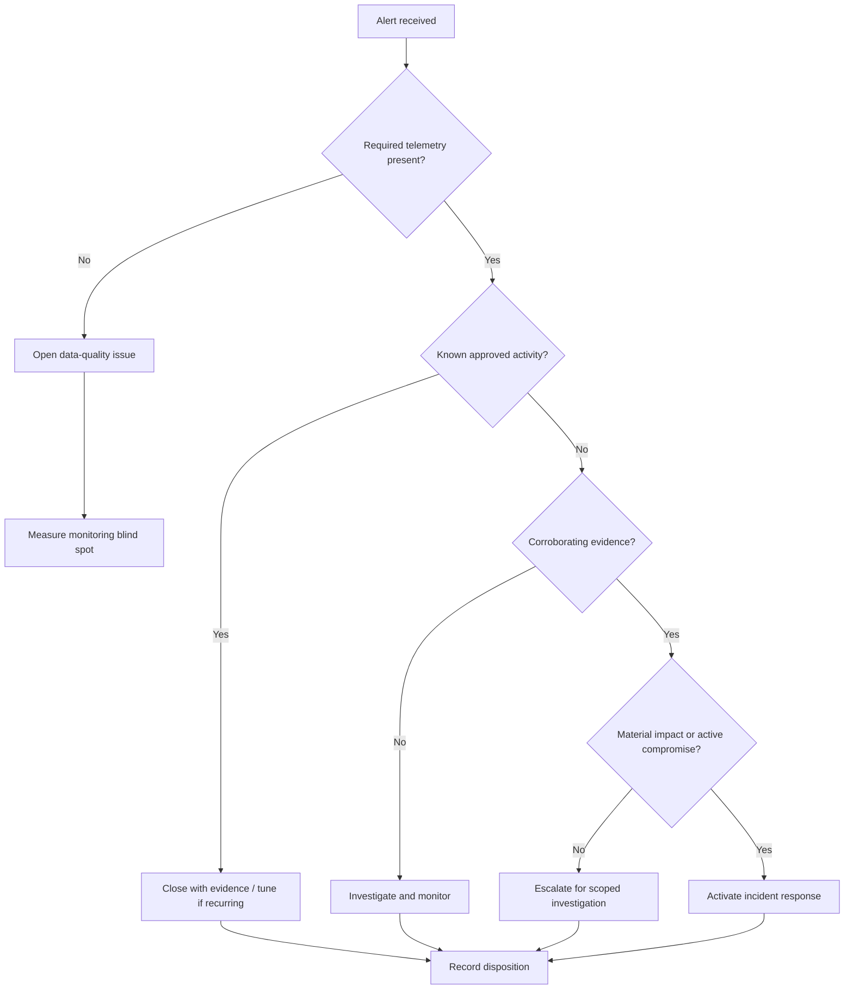

# Tuning, Validation, and Measurement Guide

## 1. Purpose

A detection rule is not complete when the query is written. It must be supplied with reliable telemetry, tested against known scenarios, introduced safely, measured, reviewed, and either improved or retired.

This guide defines how the seven proposed monitoring areas could be converted from academic designs into operational detections.

## 2. Pre-deployment checklist

### Ownership and intent

- [ ] Name a detection owner and backup owner.
- [ ] State the threat, failure, or control-health hypothesis.
- [ ] Identify affected assets and business services.
- [ ] Define severity and escalation criteria.
- [ ] Link the rule to a triage or response playbook.
- [ ] Record assumptions and exclusions.

### Telemetry readiness

- [ ] Confirm every required source is enabled and authorized.
- [ ] Confirm timestamps are synchronized.
- [ ] Validate field names, types, time zones, and identifiers.
- [ ] Measure normal ingestion delay.
- [ ] Confirm retention supports investigation needs.
- [ ] Restrict access to logs and protect them from tampering.
- [ ] Alert when a critical source stops reporting.
- [ ] Check whether privacy or legal requirements affect collection and retention.

### Baseline

- [ ] Use a representative period that includes weekdays, weekends, maintenance, backups, and expected peaks.
- [ ] Segment the baseline by asset role, location, identity, service, and time where relevant.
- [ ] Document known scanners, deployment tools, administrative systems, and batch jobs.
- [ ] Record the event distribution, not only the average.
- [ ] Avoid treating a compromised historical period as unquestionably normal.

## 3. Validation plan

### Functional test

Confirm the rule triggers when a controlled event meets the intended logic and does not trigger when the condition is absent.

### Data-quality test

Remove or alter an expected field in a safe test source. Confirm the system detects telemetry degradation rather than silently producing false confidence.

### Benign-activity test

Run approved maintenance, backup, deployment, administrative, and high-volume business activity to measure predictable false positives.

### Adversary-behaviour simulation

Where authorized and safe, reproduce representative behaviour in a lab or controlled test environment. Examples include:

- repeated failed SSH authentication followed by a successful test login;
- a controlled critical-file modification;
- a temporary endpoint-protection health change;
- an approved high-volume database query;
- a test connection fan-out between designated lab systems;
- an intentional service-start failure;
- a synthetic HTTP latency condition.

Testing must not target production or third-party systems without authorization.

### Triage test

Give the alert to an analyst with the playbook. Confirm that the alert contains enough evidence to reach a decision and that required links, ownership, and escalation paths work.

### Recovery test

Confirm suppression, rollback, and data-source restoration procedures if the rule or collection method causes operational problems.

## 4. Safe rollout

1. **Draft:** develop and peer-review the hypothesis and logic.
2. **Lab:** test with controlled events.
3. **Observe-only:** generate alerts without automated containment.
4. **Pilot:** enable for a limited, representative asset group.
5. **Tune:** document and address false positives, missing context, and performance cost.
6. **Expand:** deploy by asset group with ownership and monitoring.
7. **Review:** evaluate at a defined interval and after relevant incidents or environment changes.
8. **Retire:** disable rules that no longer address a valid hypothesis, cannot be supported with reliable data, or add more risk than value.

## 5. Threshold-tuning guidance by sensor

| Sensor | Better tuning approach than a global static threshold |
|---|---|
| HTTP response time | Endpoint/service SLOs, sustained duration, percentile latency, error rate, request rate, dependency and saturation context |
| MySQL activity | Query fingerprints, account/service peer groups, table sensitivity, rows/bytes, time window, job schedules, privilege and application context |
| SSH authentication | Failures by source/user/destination, distributed spray patterns, new-source success, privilege level, bastion/VPN context |
| Endpoint-security health | Grace period by device state, criticality, heartbeat, policy changes, fleet-wide clustering, maintenance windows |
| File integrity | Curated paths, change owner/process, approved deployments, hash changes, host role, persistence relevance |
| Windows events | Event-specific logic, sequences, process/user/service context, host role, maintenance and software-deployment context |
| Bandwidth/connections | Per-asset and peer-group baselines, direction, rare destination, connection fan-out, bytes, protocol, process, schedule |

## 6. Alert record template

Each alert should provide or link to:

- rule name and version;
- detection owner;
- event time and ingestion time;
- affected identity, asset, and business service;
- severity and confidence;
- exact condition that triggered;
- relevant raw events;
- baseline comparison;
- enrichment sources and timestamps;
- known false positives;
- recent changes or maintenance;
- first investigation steps;
- escalation path;
- evidence-preservation requirements;
- rule limitations.

## 7. Triage decision model

## 8. Detection-quality measures

### Coverage

- percentage of in-scope assets reporting required telemetry;
- percentage of critical services with defined monitoring;
- priority hypotheses with an enabled and tested detection;
- critical sources with health monitoring.

### Quality

- alert volume by rule and asset group;
- true-positive, benign-positive, and undetermined disposition;
- repeated false-positive causes;
- alerts missing required fields;
- rules with no activity over a defined period;
- duplicate or highly correlated alert rate.

### Timeliness

- source-to-platform ingestion delay;
- time from event to alert;
- time to acknowledgement;
- time to triage decision;
- time to escalation or containment when applicable.

### Effectiveness

- controlled test cases detected;
- incidents where the rule provided useful evidence;
- relevant incidents missed by the rule;
- corrective actions completed after lessons learned;
- analyst effort required per useful alert.

Metrics need consistent definitions. A high alert count is not evidence of strong detection, and a low false-positive rate can conceal missed events.

## 9. Rule-change record

For every material change, record:

- prior and new rule version;
- owner and approver;
- date and reason;
- affected sources and assets;
- expected effect on alert volume and coverage;
- test cases and results;
- rollback plan;
- review date.

## 10. Project-specific evidence boundary

The academic report provides the monitoring areas, initial numerical thresholds, risk reasoning, and recommendations. It does not provide:

- production configuration exports;
- screenshots of every configured sensor;
- raw test events;
- alert-history data;
- false-positive measurements;
- incident tickets;
- response-time metrics; or
- evidence of continuous monitoring.

Those items would be required before claiming implementation or operational effectiveness.
